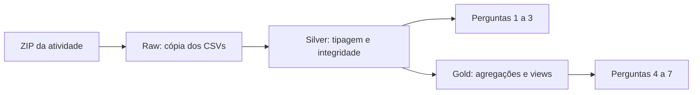

# Projeto Avaliativo de Análise de Dados: Módulo 1

**Autor:** Ednelson Rocha

**Tema:** despesas com viagens a serviço do Governo Federal

Pipeline de dados em Python e PostgreSQL que transforma os arquivos de viagens
fornecidos na atividade em tabelas relacionais, indicadores e gráficos. A solução
permite analisar custos, destinos, duração, pagamentos e meios de transporte,
preservando a origem de cada transformação.

[Repositório do projeto](https://github.com/EDNELSONRS/Projeto_Avaliativo_Modulo_1_Analise_de_Dados_Ednelson)

## Arquitetura e organização



| Camada | Implementação |
|---|---|
| Raw | Quatro tabelas com todas as 65 colunas originais como `VARCHAR`, sem constraints. |
| Silver | Quatro tabelas tipadas, com chaves primárias, estrangeiras e restrições adicionais. |
| Gold | Tabela `gold_resumo_viagem`, uma view de resumo e quatro views de métricas. |

A tabela de resumo Gold tem uma linha por viagem. Pagamentos, passagens e trechos são agregados
antes das junções para evitar multiplicação de valores. As perguntas 1 a 3 usam
SQL sobre Silver; as perguntas 4 a 7 consultam as views Gold.

Os 11 arquivos versionados são:

```text
projeto-viagens/
├── .env.example
├── .gitignore
├── 0_criar_banco.py
├── 0_criar_banco.sql
├── 1_extrair.py
├── 2_transformar.py
├── 3_analise.ipynb
├── banco.py
├── config.py
├── README.md
└── requirements.txt
```

O arquivo `.env`, o ambiente `.venv` e a pasta `data/` são locais e ficam fora do Git.

## Tecnologias e dados

Ambiente validado: **Python 3.12 e PostgreSQL 18.3**, no Windows.

- Acesso ao banco: psycopg2 e SQLAlchemy.
- Processamento e download: pandas, python-dotenv e gdown.
- Análise e gráficos: notebook Jupyter, Matplotlib e Seaborn.
- Editor: VS Code com as extensões Python e Jupyter.

A base fornecida contém viagens iniciadas de janeiro a junho de 2025. Algumas
terminam em 2026; essas datas são preservadas. O ZIP contém `2025_Viagem.csv`,
`2025_Pagamento.csv`, `2025_Passagem.csv` e `2025_Trecho.csv`, com separador `;`,
codificação Latin-1, vírgula decimal e datas no formato `DD/MM/AAAA`.

[Base da atividade no Google Drive](https://drive.google.com/file/d/1pQjKacyHdIsyteknQbwKGM5_4hL5V4RV/view)

O ID `1pQjKacyHdIsyteknQbwKGM5_4hL5V4RV` já está preenchido no modelo de
configuração. O download automático requer acesso ao arquivo compartilhado.

## Instalação no Windows

Instale Git, Python 3.12, PostgreSQL e VS Code. Inicie o serviço PostgreSQL e use
um usuário com permissão para criar bancos. Se `transparencia_viagens` já existir,
o usuário também precisa ser seu proprietário ou ter privilégios equivalentes.

No PowerShell, clone em um caminho curto e prepare o ambiente:

```powershell
git clone https://github.com/EDNELSONRS/Projeto_Avaliativo_Modulo_1_Analise_de_Dados_Ednelson.git "D:\projeto-viagens"
Set-Location "D:\projeto-viagens"
py -3.12 -m venv .venv
Set-ExecutionPolicy -Scope Process -ExecutionPolicy RemoteSigned
.\.venv\Scripts\Activate.ps1
python -m pip install --upgrade pip
python -m pip install -r requirements.txt
Copy-Item .env.example .env
```

A alteração da política de execução vale somente para o PowerShell atual.
Abra a pasta clonada no VS Code. Na primeira configuração, edite o `.env`:

```dotenv
POSTGRES_HOST=localhost
POSTGRES_PORT=5432
POSTGRES_USER=postgres
POSTGRES_PASSWORD=COLE_SUA_SENHA_AQUI
POSTGRES_DATABASE=transparencia_viagens
DRIVE_FILE_ID=1pQjKacyHdIsyteknQbwKGM5_4hL5V4RV
```

Substitua `COLE_SUA_SENHA_AQUI` pela senha do seu PostgreSQL e salve. Use aspas
simples se ela contiver `#` ou espaços. As credenciais são lidas do `.env` desta
pasta. Mantenha a senha real somente nesse arquivo: ela não deve entrar no código,
no `.env.example`, nos resultados do notebook ou no histórico Git.

Confirme a conexão administrativa com um teste que não altera o banco:

```powershell
python -c "from banco import conectar; c=conectar('template1'); print('Conexao administrativa OK'); c.close()"
```

## Execução do pipeline

Execute as etapas na ordem abaixo, com o ambiente virtual ativo.

### 0. Recriar o banco e criar as tabelas

**Esta etapa exclui e recria o banco `transparencia_viagens` inteiro, apagando seus
objetos e dados anteriores.** Use um banco dedicado ao projeto e faça backup dos
dados que precisar preservar. Desconecte sessões do pgAdmin, psql e notebooks
que estejam utilizando esse banco antes de executar:

```powershell
python 0_criar_banco.py
```

O SQL declara `DROP DATABASE IF EXISTS transparencia_viagens`,
`CREATE DATABASE transparencia_viagens TEMPLATE template0` e oito `CREATE TABLE`.
O script Python administra o banco por uma conexão com `template1`, em autocommit,
e depois cria as tabelas no banco do projeto. O nome configurado deve coincidir
com o nome explícito no SQL. Esta é a única etapa que remove o banco inteiro.

### 1. Baixar e carregar a camada Raw

```powershell
python 1_extrair.py
```

Sem um ZIP local, o script baixa a base e valida sua integridade, os quatro CSVs
e seus cabeçalhos antes da carga. O arquivo validado fica em
`data/viagens_2025_6meses.zip`. A leitura é progressiva por COPY, preservando os
valores originais. TRUNCATE e carga das quatro tabelas usam uma única transação;
uma falha reverte a carga. Reexecutar esta etapa substitui os dados Raw.

### 2. Transformar os dados para Silver

```powershell
python 2_transformar.py
```

A transformação aplica `BTRIM` aos identificadores e textos, converte datas,
inteiros e decimais brasileiros e preserva campos opcionais não informados como
nulos. PK, FK, NOT NULL, CHECK e UNIQUE asseguram a integridade definida no modelo.
As validações prévias rejeitam identificadores ausentes, registros órfãos e
pagamentos sem tipo antes de substituir Silver.

```text
valor_total = valor_diarias + valor_passagens + valor_outros_gastos - valor_devolucao
duracao_dias = data_fim - data_inicio
```

Componentes monetários ausentes contam como zero somente na composição do total.
A duração não acrescenta um dia à diferença. Os quatro TRUNCATE/INSERT ocorrem
em uma transação; reexecutar esta etapa substitui os dados Silver.

### 3. Executar as análises e conferir o resultado

1. Abra `3_analise.ipynb` no VS Code.
2. Em **Selecionar Kernel**, escolha o Python de `D:\projeto-viagens\.venv\Scripts\python.exe`.
3. Reinicie o kernel e selecione **Executar Tudo**.
4. Aguarde as sete respostas, tabelas, seis figuras e a última célula de conferência.
5. Salve com **Ctrl+S** para manter os resultados no notebook entregue.

O notebook reconstrói os objetos Gold. A última célula reconcilia as contagens
Raw/Silver, a unicidade das viagens Gold e os totais de custos, pagamentos e
trechos; também apresenta a auditoria das repetições financeiras.

## Resultados da base fornecida

| Entidade | Raw | Silver |
|---|---:|---:|
| Viagem | 341.860 | 341.860 |
| Pagamento | 606.916 | 606.916 |
| Passagem | 167.260 | 167.260 |
| Trecho | 763.349 | 763.349 |

São **1.879.385 registros por camada** e **341.860 viagens** no resumo Gold.
Os rankings completos, as consultas e os gráficos estão no notebook.

| Pergunta de negócio | Resultado principal |
|---|---|
| 1. Quais são os cinco órgãos com maior custo total? | Líder: Ministério da Justiça e Segurança Pública, R$ 486.933.121,65. |
| 2. Quais são os três destinos com maior custo médio por viagem? | Líder: Abu Dabi/Emirados Árabes, Riad/Arábia Saudita, Rio de Janeiro/RJ, R$ 245.852,80; uma viagem. |
| 3. Qual é a viagem de maior duração e seu custo? | Processo 0000000000020699856: 383 dias e custo registrado de R$ 0,00. |
| 4. Qual tipo de pagamento tem o maior valor médio? | DIÁRIAS: R$ 2.078,28 por registro de pagamento. |
| 5. Qual meio de transporte é mais usado nos trechos? | Veículo Oficial: 386.424 trechos. |
| 6. Qual UF de destino aparece em mais trechos? | São Paulo: 82.722 ocorrências. |
| 7. Qual órgão pagou mais no total? | Fundo Nacional de Segurança Pública: R$ 278.481.047,89. |

## Interpretação e qualidade dos dados

- Em Q2, destino é o roteiro completo informado na fonte, sem rateio entre cidades.
  Cada um dos três roteiros do ranking tem apenas uma viagem; a média exige essa ressalva.
- O custo zero da viagem mais longa é o valor registrado e não comprova ausência de despesas.
- Custo líquido da viagem e soma dos pagamentos são medidas diferentes e não devem ser somadas.
- A fonte tem **38.105 ocorrências excedentes de pagamentos** e **50 de passagens** com linhas
  integralmente iguais. Os registros foram preservados e sinalizados: sem identificador
  do evento ou regra de negócio confirmada, igualdade de campos não prova duplicação indevida.
- IDs gerados em Silver identificam linhas, não comprovam a unicidade de eventos financeiros.
  TRUNCATE evita acumular cargas repetidas; não deduplica os registros dentro da própria fonte.
- Campos opcionais vazios permanecem ausentes. UFs não informadas ficam fora do ranking de UFs;
  a categoria de transporte `Inválido` é preservada. Os rankings não demonstram causalidade ou eficiência.

## Melhorias futuras

Definir chaves de negócio para eventos financeiros, normalizar destinos por cidade,
adicionar retentativas de download e registrar logs persistentes de execução.

## Entrega acadêmica

Disponibilizar o link do repositório no AVA, em **Módulo 1 - Projeto Avaliativo**,
até **03/11/2026 às 22h**. Após a entrega, manter o repositório sem alterações até a correção.
